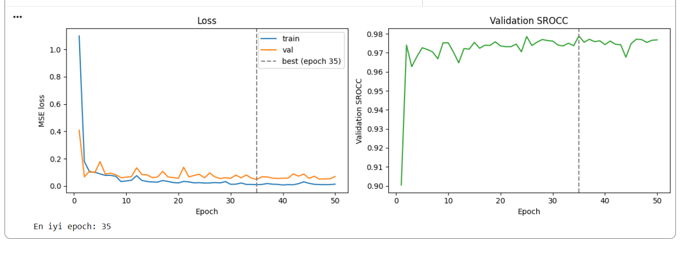
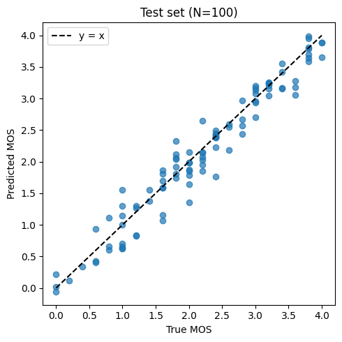

# LDCT-IQAC ResNet18 Baseline

## Citation

**If you use this code, please cite:**

```bibtex
@misc{akgun2026ldctiqac,
  title={LDCT-IQAC ResNet18 Baseline: Image Quality Score Regression on Low-Dose CT Slices},
  author={Akg{\"u}n, Ceren},
  year={2026}
}
```

## Overview

A ResNet18 regression model that predicts the Mean Opinion Score (MOS, range 0 to 4) of a single 512x512 low-dose CT slice, trained on the LDCT-IQAC 2023 (MICCAI) challenge data.

## Features

- Transfer learning from ImageNet ResNet18 with a 1-channel input layer and a 1-output head
- MSE loss, Adam optimizer, best checkpoint chosen by validation loss
- Test metrics: MAE, RMSE, PLCC, SROCC, KROCC
- Training curves and predicted vs true MOS scatter plot

## Installation

```bash
git clone <repository-url>
cd ldct-iqac-resnet18

python -m venv .venv
source .venv/bin/activate

pip install -r requirements.txt
pip install ruff pytest
```

## Dataset

**LDCT Image Quality Assessment Challenge, MICCAI 2023** ([challenge site](https://ldctiqac2023.grand-challenge.org/), [Zenodo record](https://zenodo.org/records/7833096))

- 1000 images in `.tif` format, all 512x512 float32 with values in [0, 1]
- MOS labels in `train.json`, range 0 to 4
- Expected layout: `data/LDCTIQAG2023_train/image/*.tif` and `data/LDCTIQAG2023_train/train.json`
- Train/Val/Test split: 800/100/100 images
- The split is random (seed 42) because the dataset has no patient IDs, so a patient-level split was not possible. Slices from the same patient may therefore appear in more than one split, which can make the scores optimistic.
- No resizing or rescaling is applied, the images are used as provided.

## Usage

### Training

```bash
python train.py
```

This writes the split CSVs, `history.json` and the best checkpoint (`outputs/checkpoints/best_model.pth`).

### Evaluation

```bash
python plot_curves.py
python test.py
```

`test.py` evaluates the best checkpoint once on the test split and saves metrics and the scatter plot to `outputs/`.

### Configuration

Edit `config.py` to modify hyperparameters:

```python
from dataclasses import dataclass


@dataclass
class Config:
    learning_rate: float = 1e-4
    batch_size: int = 16
    num_epochs: int = 50
    num_workers: int = 2
    seed: int = 42
```

### Quality checks

```bash
make ci
```

## Architecture

`torchvision` ResNet18 initialised with ImageNet weights (`IMAGENET1K_V1`). The first convolution is replaced by a new randomly initialised `Conv2d(1, 64, kernel_size=7, stride=2, padding=3, bias=False)` and the final layer by `Linear(512, 1)`. The model has 11,170,753 parameters.

## Results

Test set (N=100), checkpoint from epoch 35 (best validation loss 0.0488):

| Metric | Value |
| ------ | ----- |
| MAE | 0.1854 |
| RMSE | 0.2425 |
| PLCC | 0.9742 |
| SROCC | 0.9711 |
| KROCC | 0.8779 |

Results come from a single run with one random split, so they carry the caveat described in the Dataset section. Runs on other hardware or library versions may differ slightly.





## Project Structure

```
.
├── README.md
├── LICENSE (CC BY-NC 4.0)
├── Makefile
├── requirements.txt
├── pyproject.toml
├── config.py
├── data.py
├── model.py
├── train.py
├── test.py
├── plot_curves.py
├── utils.py
├── assets/
└── tests/
```

## References

- LDCT Image Quality Assessment Challenge, MICCAI 2023
- K. He et al., Deep Residual Learning for Image Recognition, CVPR 2016

## License

This project is licensed under CC BY-NC 4.0 (Creative Commons
Attribution-NonCommercial 4.0 International) - see the [LICENSE](LICENSE) file
for details.

## Contact

For questions, please open an issue in this repository or contact neuronautsai@gmail.com.
